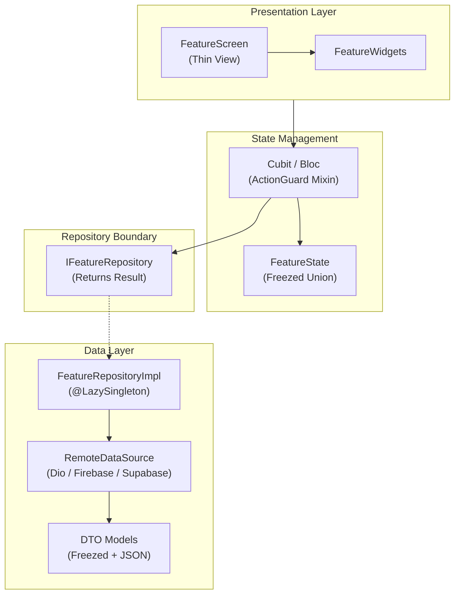

# 🚀 Flutter Starter Template

[](https://flutter.dev)
[](https://dart.dev)
[](LICENSE)
[](https://github.com/Clark605/flutter_Starter_template/actions/workflows/ci.yml)

A production-grade, reusable, backend-agnostic Flutter starter template. Built with **Bloc & Cubit**, **Freezed 3**, **Injectable DI**, **Dio** with resilient guarded actions, **Material 3** theming with full English and Arabic (RTL) support, and native multi-flavor environments.

Runs out of the box with **zero external accounts or configuration** (no Firebase/API keys required).

---

## 🏛️ Architecture Overview

The architecture enforces a strict **Feature-First Clean Architecture** without an artificial domain layer. Presentation logic depends on repository interfaces returning a sealed `Result<T>`.



---

## ✨ Features & Capabilities

- **State Management**: `flutter_bloc` with both **Cubit** and **Bloc** demonstrated and supported.
- **Guarded Actions (`ActionGuard`)**: Closed-state safety, re-entrant double-submit prevention (`key`), automatic retry with exponential backoff, and centralized error mapping.
- **Errors & Results**: Sealed `Result<T>` (`Success`, `Error`) and typed `Failure` hierarchy (`network`, `timeout`, `unauthorized`, `forbidden`, `notFound`, `validation`, `server`, `cancelled`, `unknown`) carrying stable error codes and translation keys.
- **Material 3 Theming**: Design tokens (`AppSpacing`, `AppRadius`, `AppDurations`, `Breakpoints`), dark/light themes, and locale-aware typography (Inter for English, IBM Plex Sans Arabic for Arabic).
- **Full Localization (en + ar)**: ARB-driven localizations with RTL layout safety.
- **Networking**: Dio module with timeouts, JSON headers, `AuthInterceptor` slot driven by `TokenProvider`, exponential retry interceptor, and debug-only sanitized logging.
- **Connectivity & Offline**: `ConnectivityService`, `ConnectivityCubit`, animated offline banner, and no-internet screen.
- **Observability Contracts**: `ICrashReporter`, `IAnalyticsService`, and `IRemoteConfigService` with zero-config no-op defaults, plus `ForceUpdateGate`.
- **Reference Feature (`features/example`)**: Full reference implementation demonstrating the data $\to$ repository $\to$ Cubit/Bloc $\to$ UI pattern with pagination and skeletonizer.
- **Automated Tooling**: Architecture linter (`tool/check_architecture.dart`), automated rename tool (`tool/rename.dart`), GitHub Actions CI/CD workflows, and lefthook pre-commit hooks.

---

## ⚡ Get Started in 5 Minutes

### 1. Clone or Use This Template
```bash
git clone https://github.com/your-username/flutter_starter.git my_app
cd my_app
```

### 2. Rename the Project
Run the idempotent rename script to set your app identifier, package name, and display title:
```bash
dart run tool/rename.dart --name my_app --org com.mycompany --display "My App"
```

### 3. Set Up Environment Configuration
Generate local environment files (`env/*.json`) from the committed non-secret templates:
```bash
dart run tool/setup_env.dart
```

### 4. Fetch Dependencies & Run Code Generation
```bash
flutter pub get
dart run build_runner build --delete-conflicting-outputs
```

### 5. Run the Dev Flavor
```bash
flutter run --flavor dev --dart-define-from-file=env/dev.json
```

---

## 📦 Base Template vs. Optional Modules

The core repository contains only what every production app requires. Specialized integrations live in `optional_modules/` outside `lib/`:

| Component | Base Template | Optional Module |
|---|:---:|:---:|
| State Management (`flutter_bloc`) | ✅ | — |
| REST Client (`dio`) | ✅ | — |
| Storage (`shared_preferences`, `flutter_secure_storage`) | ✅ | — |
| Design Tokens & Theming | ✅ | — |
| English + Arabic Localization | ✅ | — |
| Architecture Linter & Rename Script | ✅ | — |
| Single In-Flight JWT Refresh Lock | — | `optional_modules/auth/` |
| Biometric Security (FaceID / Fingerprint) | — | `optional_modules/auth/` |
| Push Notifications (FCM + Local Alerts) | — | `optional_modules/push_notifications/` |
| Deep Links / Universal Links | — | `optional_modules/deep_links/` |
| Local Database (Drift SQLite Cache) | — | `optional_modules/local_db/` |
| Firebase (Crashlytics, Analytics, RemoteConfig) | — | `optional_modules/firebase/` |
| Sentry Crash Reporting | — | `optional_modules/sentry/` |
| SignalR Realtime Hub | — | `optional_modules/signalr/` |
| Cloud Firestore Backend | — | `optional_modules/backend_firebase/` |
| Supabase Backend | — | `optional_modules/backend_supabase/` |
| GraphQL Backend | — | `optional_modules/backend_graphql/` |

---

## 📁 Project Structure

```
lib/
├── main.dart                      # App entry point
├── bootstrap.dart                 # Initialization, crash zones, DI & gate check
├── app.dart                       # MaterialApp, BlocProviders, Theme, L10n
├── l10n/                          # Generated localization delegates
├── core/
│   ├── config/                    # Compile-time defines (AppConfig)
│   ├── constants/                 # StorageKeys, ApiConstants
│   ├── cubit/                     # ActionGuard mixin, BaseCubit, AppSettingsCubit
│   ├── di/                        # GetIt and Injectable container
│   ├── errors/                    # AppException, Failure, Result<T>, ErrorMapper
│   ├── network/                   # DioClient, AuthInterceptor, RetryInterceptor
│   ├── observability/             # CrashReporter, Analytics, RemoteConfig, ForceUpdateGate
│   ├── routes/                    # AppRouter, AppNavigator, RouteNames, RouteProviders
│   ├── services/                  # ConnectivityService
│   ├── storage/                   # PrefsService, SecureStorageService
│   ├── theme/                     # AppSpacing, AppRadius, AppColors, AppTypography
│   ├── utils/                     # AppLogger, ResponsiveLayout, PaginationState, Validators
│   └── widgets/                   # AppButton, AppTextField, AppAvatar, StatusBadge, etc.
└── features/
    └── example/                   # Complete reference feature implementation
        ├── data/
        │   ├── models/            # Freezed ItemDto
        │   ├── datasources/       # ItemRemoteDataSource
        │   └── repositories/      # IItemRepository & ItemRepositoryImpl
        ├── cubit/                 # ExampleCubit & ExampleState
        ├── bloc/                  # ExampleDetailBloc, Event & State
        └── ui/                    # ExampleScreen, ExampleDetailScreen & ItemCard
```

---

## 📸 Screenshots

| Light Theme | Dark Theme | Arabic (RTL) |
|:---:|:---:|:---:|
| *(Screenshots placeholder)* | *(Screenshots placeholder)* | *(Screenshots placeholder)* |

---

## 📄 Documentation Index

- [Architecture Guide](docs/architecture.md)
- [Design Tokens & Theming](docs/theming.md)
- [Flavors & Environments](docs/flavors.md)
- [Backend Variants (REST / Firebase / Supabase / GraphQL)](docs/backend-variants.md)
- [Optional Modules Catalog](docs/optional-modules.md)
- [AI Agent Guidelines](AGENTS.md)

---

## ⚖️ License

Distributed under the MIT License. See [LICENSE](LICENSE) for details.
