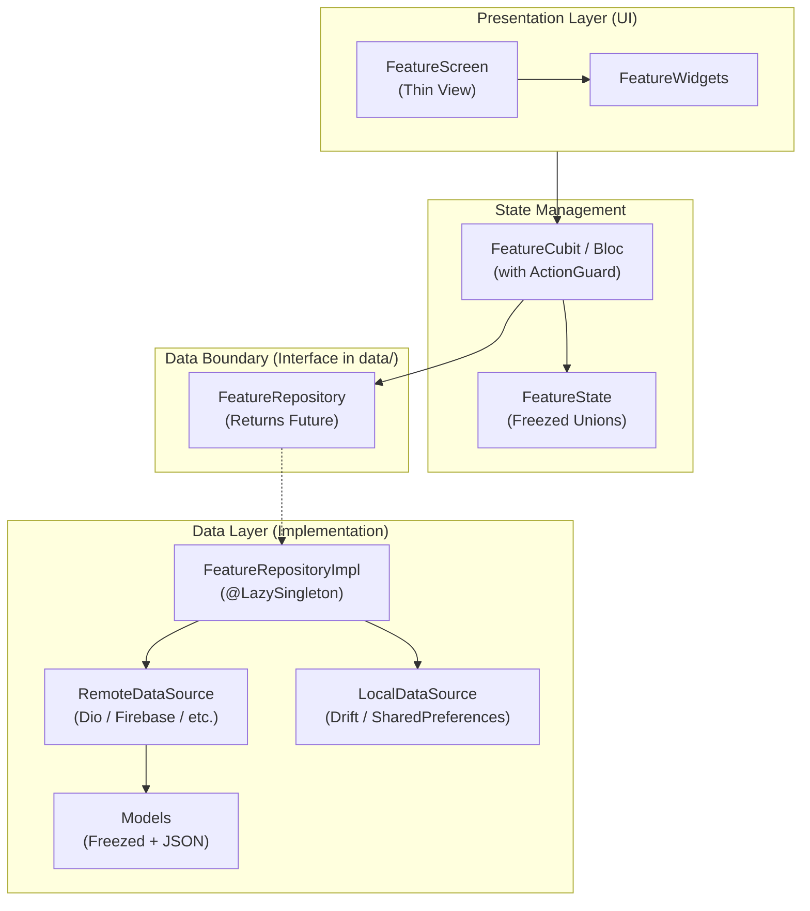

# Architectural Blueprint

`flutter_starter` implements a modular, feature-first architecture with a clean repository boundary, eliminating the overhead of an artificial domain layer. Presentation logic depends exclusively on repository interfaces (`<feature>_repository.dart`), ensuring high testability, fast compilation, and seamless backend independence.



---

## 1. The Seam: Why There Is No Domain Layer
Traditional "Clean Architecture" in Flutter frequently introduces three boilerplate layers for every feature: `Entity`, `UseCase`, and `Repository`. In 95% of mobile features, `UseCase` merely calls `Repository.method()` without adding logic.

In `flutter_starter`:
- **Repository Interface is the Domain Contract**: It defines business capability and returns plain `Future<T>`. Data sources and repositories throw; `guard()` in Cubit/Bloc is the only place errors become `Failure` / `Result<T>`.
- **DTOs are Immutable Values**: Freezed models (`*.freezed.dart`, `*.g.dart`) provide serialization, deep equality, and `copyWith`.
- **No Direct Data Source Leaks**: Cubits never see Dio, Firebase, or Supabase.

---

## 2. Guarded Actions (`ActionGuard`)

`ActionGuard<S>` is a robust mixin on `BlocBase<S>` that encapsulates asynchronous safety, duplicate suppression, and error handling. For cancelling HTTP requests, pass Dio's `CancelToken` to the data source.

### Features & Protections:
- **Explicit Result Types**: Returns `Result<T>` (`Success` or `Failure`).
- **Closed-State Safety**: Checks whether the Cubit is closed or `Emitter.isDone` before and after async operations.
- **Double-Submit Prevention (`key`)**: Concurrent invocations sharing the same action `key` reject the duplicate call with `Failure.cancelled(code: 'DUPLICATE_ACTION')`.
- **Decoupled Crash Reporting**: Decoupled from the service locator via `ActionGuardConfig.crashReporter` configured during `bootstrap()`.
- **Single Retry Layer**: Automatic retry for transient HTTP failures is handled at the network level by `RetryInterceptor`.

### Cubit Example:
```dart
@injectable
class ExampleCubit extends BaseCubit<ExampleState> {
  final ItemRepository _repository;

  ExampleCubit(this._repository) : super(const ExampleState.initial());

  Future<void> loadItems() async {
    emit(const ExampleState.loading());

    final result = await guard<List<ItemModel>>(
      () => _repository.getItems(page: 1, limit: 10),
      key: 'load_items_initial',
    );

    result.fold(
      (items) => emit(ExampleState.loaded(items: items, page: 1, hasMore: true)),
      (failure) {
        if (failure is! CancelledFailure) {
          emit(ExampleState.error(failure));
        }
      },
    );
  }
}
```

### Bloc Example with `Emitter.isDone` Safety:
```dart
@injectable
class ExampleDetailBloc extends Bloc<ExampleDetailEvent, ExampleDetailState>
    with ActionGuard<ExampleDetailState> {
  final ItemRepository _repository;

  ExampleDetailBloc(this._repository) : super(const ExampleDetailState.initial()) {
    on<ExampleDetailEvent>((event, emit) async {
      await event.when(
        load: (id) => _onLoad(id, emit),
        refresh: (id) => _onRefresh(id, emit),
      );
    });
  }

  Future<void> _onLoad(int id, Emitter<ExampleDetailState> emit) async {
    emit(const ExampleDetailState.loading());

    final result = await guard<ItemModel>(
      () => _repository.getItem(id),
      key: 'load_item_detail_$id',
      emitter: emit, // Checked for emitter.isDone
    );

    result.fold(
      (item) => emit(ExampleDetailState.loaded(item)),
      (failure) {
        if (failure is! CancelledFailure) {
          emit(ExampleDetailState.error(failure));
        }
      },
    );
  }
}
```

---

## 3. Pluggable Error Mapping & Failures

Errors are mapped centrally without coupling core models to specific network transports.

### Sealed `Failure` Hierarchy:
- `NetworkFailure` (`NETWORK_ERROR`)
- `TimeoutFailure` (`TIMEOUT_ERROR`)
- `UnauthorizedFailure` (`UNAUTHORIZED`, triggers session expiration)
- `ForbiddenFailure` (`FORBIDDEN`)
- `NotFoundFailure` (`NOT_FOUND`)
- `ConflictFailure` (`CONFLICT`, HTTP 409 or duplicate resource)
- `ValidationFailure` (`VALIDATION_ERROR`, includes `fieldErrors` map)
- `ServerFailure` (`SERVER_ERROR`, carries `statusCode`)
- `CancelledFailure` (`CANCELLED`, bloc closed or request cancelled)
- `UnknownFailure` (`UNKNOWN_ERROR`)

### Pluggable Mapper Registry:
Custom mappers are registered with `ErrorMapper.register()` in `bootstrap()`:

```dart
// Registering Dio mapper (default in core/network):
ErrorMapper.register(mapDioException);

// Registering third-party backend mappers (e.g. Firebase, Supabase):
ErrorMapper.register((error, stackTrace) {
  if (error is FirebaseException) {
    return switch (error.code) {
      'permission-denied' => Failure.forbidden(code: error.code),
      'not-found' => Failure.notFound(code: error.code),
      _ => Failure.server(code: error.code),
    };
  }
  return null; // Return null to delegate to next registered mapper
});
```

### HTTP Status Code Mappings in `dio_error_mapper.dart`:
- `400` -> `Failure.validation` with field errors.
- `401` -> `Failure.unauthorized`.
- `403` -> `Failure.forbidden`.
- `404` -> `Failure.notFound`.
- `408` -> `Failure.timeout(code: 'REQUEST_TIMEOUT')`.
- `409` -> `Failure.conflict(code: 'CONFLICT')`.
- `422` -> `Failure.validation(code: 'UNPROCESSABLE_ENTITY')` with field errors.
- `429` -> `Failure.server(code: 'TOO_MANY_REQUESTS')`.
- `502`, `503`, `504` -> `Failure.server(code: 'SERVER_UNAVAILABLE')`.
- Other `5xx` -> `Failure.server()`.

---

## 4. Central Routing & Navigation Guarding

The application uses an explicit route generator in `AppRouter` driven by `RouteNames` and `route_providers.dart`:

### Typed Route Arguments:
Routes with parameters require explicit typed argument objects:
```dart
// Navigating with typed argument:
AppNavigator.pushNamed(
  RouteNames.exampleDetail,
  arguments: ExampleDetailArgs(itemId: item.id),
);
```

If arguments are missing, corrupt, or invalid (e.g. `itemId <= 0`), `buildExampleDetailRoute` redirects safely to `buildNotFoundRoute(RouteNames.exampleDetail)` (404 Screen) rather than failing silently with default zeros.

### Pluggable Authentication Redirects:
Navigation guards use the `AuthRedirect` function typedef:

```dart
// Configured in bootstrap or main:
AppRouter.authRedirect = (routeName) {
  if (routeName == RouteNames.home && !getIt<TokenProvider>().hasValidToken) {
    return RouteNames.onboarding;
  }
  return null; // Allow normal navigation
};
```

---

## 5. Startup Bootstrap Sequence

The application boot flow in [`lib/bootstrap.dart`](../lib/bootstrap.dart) is engineered for resilience, ensuring the splash screen is never hung:

1. **Native Splash Preservation**: Calls `FlutterNativeSplash.preserve()` immediately after `WidgetsFlutterBinding.ensureInitialized()` to prevent white/black flash before initial frame.
2. **Early Error Buffering**: Installs `FlutterError.onError` and `PlatformDispatcher.instance.onError` before DI. Logs all errors immediately and buffers them in memory.
3. **Mapper & Dependency Registration**: Registers `mapDioException` and invokes `configureDependencies()` to register core services, Dio networking, storage, and repositories.
4. **Crash Reporter Online & Buffer Flush**: Initializes `ICrashReporter` and flushes any pre-initialization errors. Sets `ActionGuardConfig.crashReporter`.
5. **Remote Config with Timeout**: Calls `remoteConfig.init()` and `fetchAndActivate()` bounded by `AppConfig.remoteConfigTimeout` (default: 3 seconds). If network stalls or times out, it gracefully falls back to compile-time defaults.
6. **Force-Update & Maintenance Gate**: Evaluates `ForceUpdateGate` against min version and maintenance flags:
   - `GateStatus.maintenance` -> Routes to `MaintenanceScreen` (`/maintenance`) with back-navigation blocked.
   - `GateStatus.updateRequired` -> Routes to `UpdateRequiredScreen` (`/update-required`) with store launch link.
   - `GateStatus.normal` -> Routes to onboarding or home screen based on `PrefsService.hasSeenOnboarding`.
7. **Guaranteed Splash Removal**: Handled in a `finally` block with `FlutterNativeSplash.remove()` so that even in case of an uncaught boot exception, the splash is cleared and the app transitions to `RouteNames.error`.

---

## 6. Architecture Linter (`tool/check_architecture.dart`)

Enforces the 8 Golden Rules through automated static analysis:
```bash
# Run validation check
dart run tool/check_architecture.dart

# List all rules and ignore formats
dart run tool/check_architecture.dart --list-rules
```

### The 8 Rules:
1. **Rule 1: No domain layer**: Cubits/Blocs depend on repository interfaces (`data/repositories/<feature>_repository.dart`), never on data sources (`data/datasources/`) or concrete implementations (`*_impl.dart`).
2. **Rule 2: Result types**: UI never sees transport types (Dio, Firebase, Supabase, GraphQL). Data sources and repositories throw; `guard()` returns `Result<T>`.
3. **Rule 3: Freezed unions & ActionGuard**: State classes are Freezed unions; Cubits/Blocs use `ActionGuard` for all async operations.
4. **Rule 4: Registration**: Repository implementations use `@LazySingleton`; Cubits/Blocs use `@injectable`.
5. **Rule 5: Zero cross-feature imports**: Features never import other features. `lib/core/` cannot import `lib/features/` (except the central `route_providers.dart` assembly root).
6. **Rule 6: Thin screens**: Screens only read state from Cubit/Bloc and render. UI files cannot import `data/repositories/` or `core/di/injection.dart`.
7. **Rule 7: L10n & Central routing**: User-facing strings must use `l10n`. Routes must be declared centrally in `RouteNames` and `AppRouter`.
8. **Rule 8: Design tokens & Clean code**: No raw `print()` calls in production code. Use `AppLogger` instead.

### Documented Inline Exceptions:
To suppress an architectural rule for a documented, intentional exception:
```dart
// architecture-ignore: rule-6 Custom screen requires direct injection
```

---

## 7. Web Support

`flutter_starter` is engineered with web-safe conditional imports:
- Network socket checks (`is_socket_error.dart`) use conditional exports (`is_socket_error_io.dart` for native platforms, `is_socket_error_stub.dart` for web) to avoid bundling `dart:io`.
- No raw `dart:io` imports exist in core or shared feature code.
- To run on web:
  ```bash
  flutter run -d chrome --flavor dev --dart-define-from-file=env/dev.json
  ```
